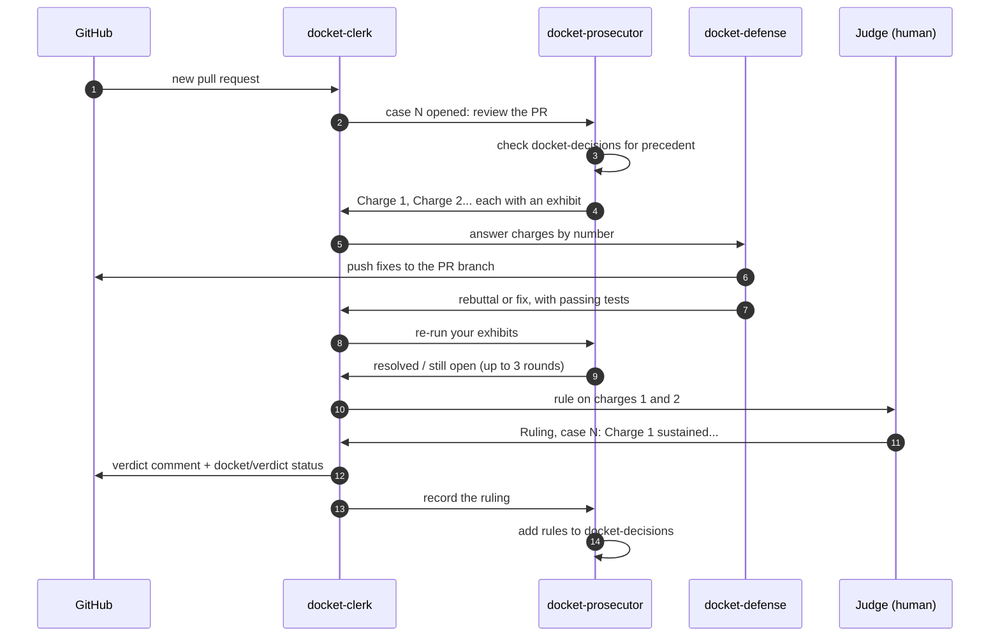

# Docket

**Put every pull request on trial.** Docket runs code review as a courtroom inside a [Switch](https://github.com/sandbox-quantum/switch) room: a prosecutor agent files charges backed by real failing tests, a defense agent rebuts or fixes them, a clerk keeps the docket, and a human judge rules. Every ruling becomes case law that the agents cite on later pull requests.

Built for the [Flip the Switch](https://www.wemakedevs.org/hackathons/switch) hackathon, Track 01: Best Business Workflow.

- Demo repo: [suhrith13/docket-demo-shop](https://github.com/suhrith13/docket-demo-shop) (its bugs are planted on purpose; see [Honesty notes](#honesty-notes))
- Demo video: _link to add_

## Why

AI code review tends to bury reviewers in comments, and few of them are worth reading. Docket changes the rules instead of the model:

- **No evidence, no charge.** Every charge needs an exhibit: a test or script the prosecutor actually ran against the PR branch, with the exact output. The clerk dismisses a charge without one.
- **Two sides.** A second agent is paid to disagree. It fixes what's real and pushes back on what isn't, so the judge sees an argument, not a list.
- **A human decides.** Only the judge rules, and nothing merges on its own.
- **Rulings compound.** Each ruling adds a general rule to the room's case law, so the team's standards come from real decisions instead of a style guide nobody reads.

## How a case runs



Everything above happens in one Switch room, `docket-court`, bridged to a Mattermost channel. The judge watches the whole trial in team chat and approves each agent action as it comes.

## What happened in the first trials

| Case | PR | What the prosecutor found | Outcome |
| --- | --- | --- | --- |
| 1 | Order history and loyalty discount | Pagination skips the newest page; the discount can go negative (both planted) | Both sustained, fixed by the defense |
| 2 | Order search | The same pagination mistake, **citing case 1**; and a test that can never fail because it runs `all()` over an empty page (**not planted**) | Both sustained, fixed; a new rule on tests |
| 3 | Average order total, opened and run by the clerk | Division by zero on no orders; a missing test, **citing case 2** | Charge 1 sustained, verdict posted to the PR by the clerk |

The resulting case law is in [room/docket-decisions.md](room/docket-decisions.md).

## How Docket uses Switch

Docket is built out of Switch features; take Switch away and there is no court.

| Docket needs | Switch provides |
| --- | --- |
| Two agents and a human in one conversation | A room, bridged to Mattermost, with Claude Code agents as members |
| Court rules every agent follows | The room's instructions ([room/court-rules.md](room/court-rules.md)), sent to each agent as it joins |
| Case law shared by all agents | A room document, `docket-decisions`, that the prosecutor writes and every agent reads |
| Turn-taking | Mentions: a post naming an agent addresses it in the room |
| A human in control | Switch's per-action approvals: the judge allows or declines every command an agent wants to run |
| A custom agent next to Claude Code | The agent protocol, implemented in [clerk/switch_client.py](clerk/switch_client.py) (see the limitation below) |

## Run it yourself

You need Windows, macOS or Linux with Docker Desktop, [Switch Console](https://github.com/sandbox-quantum/switch/releases/latest), Claude Code with a Claude Pro (or higher) plan, Git, Python 3.11+ and a GitHub account.

1. **Set up Switch.** Install Switch Console and follow its setup until switch-buddy answers you. Pick Claude Code as the provider.
2. **Fork or clone the demo repo** into a folder on your computer:
   ```bash
   git clone https://github.com/suhrith13/docket-demo-shop
   ```
   Push it to a repo of your own if you want the clerk to post verdicts there.
3. **Create the agents and the room.** Send switch-buddy the two messages in [room/setup-with-switch-buddy.md](room/setup-with-switch-buddy.md).
4. **Run the clerk:**
   ```bash
   git clone https://github.com/suhrith13/Docket && cd Docket
   python -m venv .venv
   .venv\Scripts\activate        # macOS/Linux: source .venv/bin/activate
   pip install -r requirements.txt
   copy .env.example .env        # macOS/Linux: cp .env.example .env
   ```
   Fill in `.env`: the Mattermost password (Switch Console → Home → the ⋮ on the Mattermost row → **Sign-in details**), and a fine-grained GitHub token for your demo repo with **Pull requests** and **Commit statuses** set to read and write. Then:
   ```bash
   python -m clerk check
   python -m clerk run
   ```
5. **Open a pull request** on your demo repo. Within 20 seconds the clerk opens a case in `docket-court`. Approve the agents' actions as they ask, and rule when the clerk asks you to:
   ```
   Ruling, case 1: Charge 1 sustained, Charge 2 overruled. PR #1 may be merged.
   ```

## The clerk

The clerk is about 800 lines of Python, in [clerk/](clerk/):

| File | Does |
| --- | --- |
| [court.py](clerk/court.py) | The court's rules as a state machine: prosecution → defense → verify → ruling → closed. Pure logic, no network. |
| [mattermost_client.py](clerk/mattermost_client.py) | Follows the room through its Mattermost channel and posts there |
| [switch_client.py](clerk/switch_client.py) | The same, as a registered Switch agent over the agent protocol (WebSocket events, HTTP posts) |
| [github.py](clerk/github.py) | Notices new pull requests and posts verdicts |
| [state.py](clerk/state.py) | Saves the docket, so a restart doesn't reopen or forget cases |

Rules it enforces:

- A charge without an exhibit is dismissed.
- Turns go prosecutor → defense → prosecutor (verify) → judge, at most 3 rounds.
- Only the judge rules, and a case stays open until every charge has a ruling.
- A ruling on a closed case amends it, and the amended verdict is posted too.

### Known limitation: how the clerk joins the room

The clerk is written to join as its own Switch agent over the agent protocol ([switch_client.py](clerk/switch_client.py), tested against a fake bridge in [tests/test_integration.py](tests/test_integration.py)). Registering a custom agent needs a registration key, which is created on the server's API Keys page. On Windows, Switch Console runs the local server without Docker, and that server has no web admin pages, so there is no way to create the key. Switch's own assistant confirmed this.

So the clerk has a second transport, the default: it follows the room through the Mattermost channel Switch bridges into it, and posts there from the judge's account, starting each post with `[Clerk]`. Switch relays those posts into the room, so mentioning an agent still hands it the turn, and the room rules tell the agents that `[Clerk]` posts are not rulings. On a server with an API Keys page, set `TRANSPORT=switch` and run `python -m clerk register` once.

## Tests

```bash
python -m pytest -q
```

17 tests, run on every push by [GitHub Actions](.github/workflows/tests.yml):

- [tests/test_court.py](tests/test_court.py): the court's rules, against messages shaped like the real trials
- [tests/test_mattermost.py](tests/test_mattermost.py): a whole case through a fake Mattermost and a fake GitHub
- [tests/test_integration.py](tests/test_integration.py): a whole case through a fake Switch bridge speaking the agent protocol

## Honesty notes

- The demo repo's first bugs are **planted on purpose** so the demo is reproducible; its README lists them. The agents' runs, test output, fixes and rulings are all real.
- Case 2's second charge (a test that could never fail) was **not planted**: the prosecutor found it.
- No ruling was pre-written. The case law in [room/docket-decisions.md](room/docket-decisions.md) was recorded by the prosecutor after each real ruling.
- Built with Claude Code's help. Every change was reviewed, and I can walk through any part of it.

## Credits

- [Switch](https://github.com/sandbox-quantum/switch) by SandboxAQ, for rooms, agents and the agent protocol
- [Claude Code](https://claude.com/claude-code), which runs both agents

MIT licensed. See [LICENSE](LICENSE).
